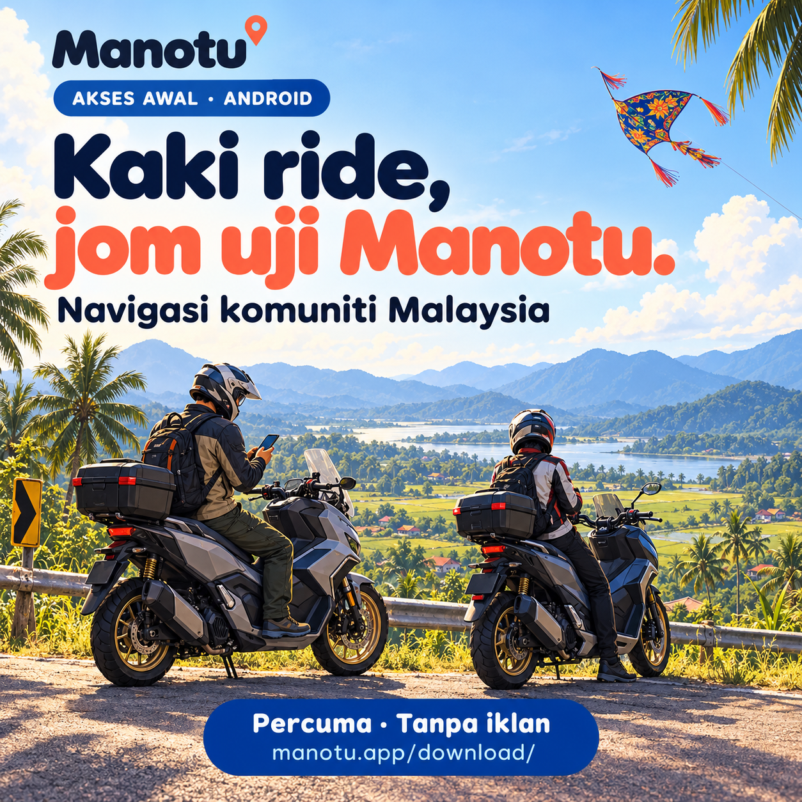
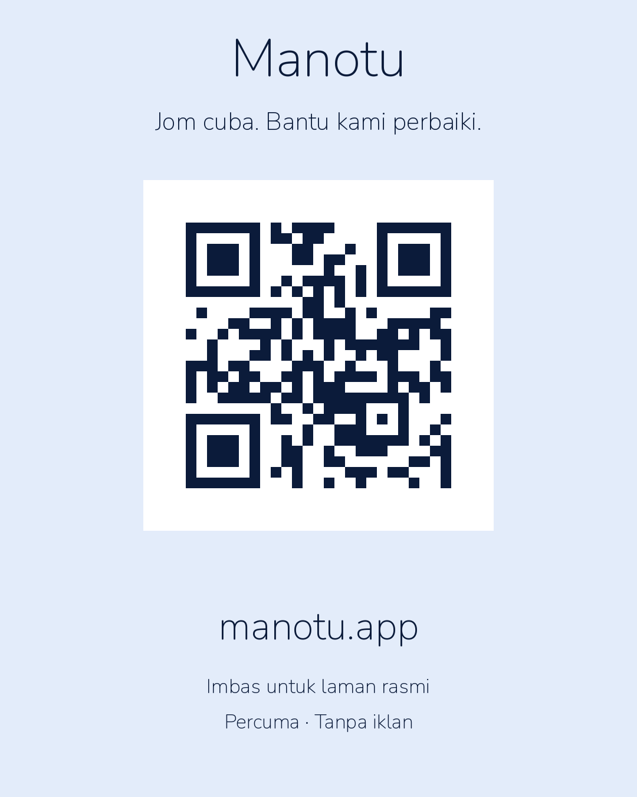

# Manotu first-wave posts

Prepared 24 October 2026. Drafts only; no posts sent. Group rules are unverified because WS556 app permissions rejected inspection. Facebook group names come from user screenshots; WhatsApp destinations still need verification. No group affiliation or endorsement is implied.

## ADVENTURE TOURING MALAYSIA ( AtM )

**Channel:** Facebook · **Check:** Unverified — host app permissions blocked inspection

Salam geng AtM! Saya sedang membina Manotu, aplikasi navigasi komuniti untuk Malaysia. Saya mencari rider yang sudi cuba laluan biasa dan bantu semak arahan di simpang, carian destinasi dan laluan alternatif.

Percuma, tanpa iklan. Tempat kegemaran dan sejarah perjalanan peribadi kekal dalam telefon, bukan di pelayan kami. Kami tidak menjual data pengguna. Manotu menerima perkongsian awam dan isyarat trafik tanpa nama untuk membantu komuniti.

Laman rasmi: https://manotu.app/
Android: https://manotu.app/download/

Ini akses awal — liputan trafik dan kualiti laluan masih berkembang. Cuba satu perjalanan yang anda kenal, kemudian beri maklum balas melalui app selepas berhenti dengan selamat. Jangan kongsi alamat rumah atau sejarah perjalanan peribadi di ruangan komen.

Kod Manotu berlesen MIT: https://github.com/erymuzuan/manotu
Komponen platform Google dan Apple turut digunakan dan didokumenkan di repositori.

Terima kasih kerana membantu kami membina pilihan navigasi untuk Malaysia!

---

## SYM Husky ADV 150/200 Malaysia Official

**Channel:** Facebook · **Check:** Unverified — host app permissions blocked inspection

Salam geng HUSKY! Ada yang sudi jadi penguji awal Manotu? Kami sedang membina aplikasi navigasi komuniti untuk Malaysia dan perlukan maklum balas rider untuk perjalanan harian serta hujung minggu. Cuba mod motosikal di laluan yang anda kenal: adakah arahannya jelas dan laluannya sesuai?

Percuma, tanpa iklan. Tempat kegemaran dan sejarah perjalanan peribadi kekal dalam telefon, bukan di pelayan kami. Kami tidak menjual data pengguna. Manotu menerima perkongsian awam dan isyarat trafik tanpa nama untuk membantu komuniti.

Laman rasmi: https://manotu.app/
Android: https://manotu.app/download/

Ini akses awal — liputan trafik dan kualiti laluan masih berkembang. Cuba satu perjalanan yang anda kenal, kemudian beri maklum balas melalui app selepas berhenti dengan selamat. Jangan kongsi alamat rumah atau sejarah perjalanan peribadi di ruangan komen.

Kod Manotu berlesen MIT: https://github.com/erymuzuan/manotu
Komponen platform Google dan Apple turut digunakan dan didokumenkan di repositori.

Terima kasih kerana membantu kami membina pilihan navigasi untuk Malaysia!

---

## Honda ADV 160 Malaysia Official Club

**Channel:** Facebook · **Check:** Unverified — host app permissions blocked inspection

Salam geng ADV 160! Saya nak jemput yang berminat mencuba Manotu, aplikasi navigasi komuniti untuk Malaysia yang masih dalam akses awal. Kami perlukan bantuan rider untuk semak carian tempat, arahan suara dan kesesuaian laluan motosikal.

Percuma, tanpa iklan. Tempat kegemaran dan sejarah perjalanan peribadi kekal dalam telefon, bukan di pelayan kami. Kami tidak menjual data pengguna. Manotu menerima perkongsian awam dan isyarat trafik tanpa nama untuk membantu komuniti.

Laman rasmi: https://manotu.app/
Android: https://manotu.app/download/

Ini akses awal — liputan trafik dan kualiti laluan masih berkembang. Cuba satu perjalanan yang anda kenal, kemudian beri maklum balas melalui app selepas berhenti dengan selamat. Jangan kongsi alamat rumah atau sejarah perjalanan peribadi di ruangan komen.

Kod Manotu berlesen MIT: https://github.com/erymuzuan/manotu
Komponen platform Google dan Apple turut digunakan dan didokumenkan di repositori.

Terima kasih kerana membantu kami membina pilihan navigasi untuk Malaysia!

---

## HONDA ADV 350 OFFICIAL MALAYSIA

**Channel:** Facebook · **Check:** Unverified — host app permissions blocked inspection

Salam geng ADV 350! Kami mencari penguji awal Manotu untuk perjalanan harian dan touring dalam Malaysia. Cuba laluan yang anda biasa guna dan beritahu kami jika ada simpang mengelirukan, arahan suara kurang jelas atau cadangan jalan yang tidak sesuai untuk motosikal.

Percuma, tanpa iklan. Tempat kegemaran dan sejarah perjalanan peribadi kekal dalam telefon, bukan di pelayan kami. Kami tidak menjual data pengguna. Manotu menerima perkongsian awam dan isyarat trafik tanpa nama untuk membantu komuniti.

Laman rasmi: https://manotu.app/
Android: https://manotu.app/download/

Ini akses awal — liputan trafik dan kualiti laluan masih berkembang. Cuba satu perjalanan yang anda kenal, kemudian beri maklum balas melalui app selepas berhenti dengan selamat. Jangan kongsi alamat rumah atau sejarah perjalanan peribadi di ruangan komen.

Kod Manotu berlesen MIT: https://github.com/erymuzuan/manotu
Komponen platform Google dan Apple turut digunakan dan didokumenkan di repositori.

Terima kasih kerana membantu kami membina pilihan navigasi untuk Malaysia!

---

## HONDA CRV 2023 6th Gen Malaysia Community

**Channel:** Facebook · **Check:** Unverified — host app permissions blocked inspection

Salam geng CR-V! Saya sedang membina Manotu, aplikasi navigasi komuniti untuk Malaysia. Kami mencari penguji awal untuk cuba satu perjalanan biasa: pergi kerja, hantar anak atau balik kampung. Adakah carian tempat tepat, arahan suara jelas dan laluan masuk akal?

Percuma, tanpa iklan. Tempat kegemaran dan sejarah perjalanan peribadi kekal dalam telefon, bukan di pelayan kami. Kami tidak menjual data pengguna. Manotu menerima perkongsian awam dan isyarat trafik tanpa nama untuk membantu komuniti.

Laman rasmi: https://manotu.app/
Android: https://manotu.app/download/

Ini akses awal — liputan trafik dan kualiti laluan masih berkembang. Cuba satu perjalanan yang anda kenal, kemudian beri maklum balas melalui app selepas berhenti dengan selamat. Jangan kongsi alamat rumah atau sejarah perjalanan peribadi di ruangan komen.

Kod Manotu berlesen MIT: https://github.com/erymuzuan/manotu
Komponen platform Google dan Apple turut digunakan dan didokumenkan di repositori.

Terima kasih kerana membantu kami membina pilihan navigasi untuk Malaysia!

---

## Malaysian Electric Vehicle Owners Club

**Channel:** Facebook · **Check:** Unverified — host app permissions blocked inspection

Hi semua! Kami mencari penguji awal Manotu, aplikasi navigasi komuniti untuk Malaysia. Kami ingin tahu pengalaman anda menggunakan navigasi telefon untuk perjalanan biasa: carian destinasi, arahan simpang dan perubahan laluan. Fokus ujian ini ialah navigasi umum; kami belum menjanjikan perancangan pengecasan berdasarkan bateri atau status pengecas masa nyata.

Percuma, tanpa iklan. Tempat kegemaran dan sejarah perjalanan peribadi kekal dalam telefon, bukan di pelayan kami. Kami tidak menjual data pengguna. Manotu menerima perkongsian awam dan isyarat trafik tanpa nama untuk membantu komuniti.

Laman rasmi: https://manotu.app/
Android: https://manotu.app/download/

Ini akses awal — liputan trafik dan kualiti laluan masih berkembang. Cuba satu perjalanan yang anda kenal, kemudian beri maklum balas melalui app selepas berhenti dengan selamat. Jangan kongsi alamat rumah atau sejarah perjalanan peribadi di ruangan komen.

Kod Manotu berlesen MIT: https://github.com/erymuzuan/manotu
Komponen platform Google dan Apple turut digunakan dan didokumenkan di repositori.

Terima kasih kerana membantu kami membina pilihan navigasi untuk Malaysia!

---

## Zeekr 7X Malaysia Group

**Channel:** Facebook · **Check:** Unverified — host app permissions blocked inspection

Hi geng Zeekr 7X! Saya nak jemput yang berminat mencuba Manotu, aplikasi navigasi komuniti untuk Malaysia. Untuk ujian awal ini, gunakan app di telefon dan cuba satu perjalanan biasa. Kami perlukan maklum balas tentang carian tempat, arahan suara dan laluan. Integrasi skrin kereta belum tersedia.

Percuma, tanpa iklan. Tempat kegemaran dan sejarah perjalanan peribadi kekal dalam telefon, bukan di pelayan kami. Kami tidak menjual data pengguna. Manotu menerima perkongsian awam dan isyarat trafik tanpa nama untuk membantu komuniti.

Laman rasmi: https://manotu.app/
Android: https://manotu.app/download/

Ini akses awal — liputan trafik dan kualiti laluan masih berkembang. Cuba satu perjalanan yang anda kenal, kemudian beri maklum balas melalui app selepas berhenti dengan selamat. Jangan kongsi alamat rumah atau sejarah perjalanan peribadi di ruangan komen.

Kod Manotu berlesen MIT: https://github.com/erymuzuan/manotu
Komponen platform Google dan Apple turut digunakan dan didokumenkan di repositori.

Terima kasih kerana membantu kami membina pilihan navigasi untuk Malaysia!

---

## Developer Kaki

**Channel:** Facebook · **Check:** Unverified — host app permissions blocked inspection

Hi kakis! Saya sedang membina Manotu, aplikasi navigasi komuniti Malaysia dengan kod sendiri berlesen MIT. Saya mencari early testers yang sudi beri feedback tentang installation, search, routing, voice guidance dan backup/restore. Android menggunakan Kotlin/Compose, iOS Swift/SwiftUI, backend .NET; peta OpenStreetMap dan routing Valhalla.

Kalau jumpa bug, versi app, model telefon, versi OS dan langkah untuk ulang masalah sangat membantu — kongsi hanya maklumat yang anda selesa, tanpa lokasi atau data peribadi.

Percuma, tanpa iklan. Tempat kegemaran dan sejarah perjalanan peribadi kekal dalam telefon, bukan di pelayan kami. Kami tidak menjual data pengguna. Manotu menerima perkongsian awam dan isyarat trafik tanpa nama untuk membantu komuniti.

Laman rasmi: https://manotu.app/
Android: https://manotu.app/download/

Ini akses awal — liputan trafik dan kualiti laluan masih berkembang. Cuba satu perjalanan yang anda kenal, kemudian beri maklum balas melalui app selepas berhenti dengan selamat. Jangan kongsi alamat rumah atau sejarah perjalanan peribadi di ruangan komen.

Kod Manotu berlesen MIT: https://github.com/erymuzuan/manotu
Komponen platform Google dan Apple turut digunakan dan didokumenkan di repositori.

Terima kasih kerana membantu kami membina pilihan navigasi untuk Malaysia!

---

## KECEK ORE JELI

**Channel:** Facebook · **Check:** Unverified — host app permissions blocked inspection

Salam ore Jeli! Saya sedang membina Manotu, aplikasi navigasi komuniti untuk Malaysia. Saya mencari orang tempatan yang sudi cuba carian tempat awam dan jalan yang biasa dilalui sekitar Jeli. Kalau nama tempat susah dicari atau arahan di simpang mengelirukan, maklum balas anda sangat membantu.

Percuma, tanpa iklan. Tempat kegemaran dan sejarah perjalanan peribadi kekal dalam telefon, bukan di pelayan kami. Kami tidak menjual data pengguna. Manotu menerima perkongsian awam dan isyarat trafik tanpa nama untuk membantu komuniti.

Laman rasmi: https://manotu.app/
Android: https://manotu.app/download/

Ini akses awal — liputan trafik dan kualiti laluan masih berkembang. Cuba satu perjalanan yang anda kenal, kemudian beri maklum balas melalui app selepas berhenti dengan selamat. Jangan kongsi alamat rumah atau sejarah perjalanan peribadi di ruangan komen.

Kod Manotu berlesen MIT: https://github.com/erymuzuan/manotu
Komponen platform Google dan Apple turut digunakan dan didokumenkan di repositori.

Terima kasih kerana membantu kami membina pilihan navigasi untuk Malaysia!

---

## ANAK-ANAK BUKIT BUNGA

**Channel:** Facebook · **Check:** Unverified — host app permissions blocked inspection

Salam warga Bukit Bunga! Kami mencari penguji awal Manotu, aplikasi navigasi komuniti untuk Malaysia. Orang tempatan paling kenal jalan sendiri — jom bantu semak carian kedai, tempat awam dan arahan jalan sekitar kawasan kita.

Percuma, tanpa iklan. Tempat kegemaran dan sejarah perjalanan peribadi kekal dalam telefon, bukan di pelayan kami. Kami tidak menjual data pengguna. Manotu menerima perkongsian awam dan isyarat trafik tanpa nama untuk membantu komuniti.

Laman rasmi: https://manotu.app/
Android: https://manotu.app/download/

Ini akses awal — liputan trafik dan kualiti laluan masih berkembang. Cuba satu perjalanan yang anda kenal, kemudian beri maklum balas melalui app selepas berhenti dengan selamat. Jangan kongsi alamat rumah atau sejarah perjalanan peribadi di ruangan komen.

Kod Manotu berlesen MIT: https://github.com/erymuzuan/manotu
Komponen platform Google dan Apple turut digunakan dan didokumenkan di repositori.

Terima kasih kerana membantu kami membina pilihan navigasi untuk Malaysia!

---

## Group Tanah Merah,Machang,Jeli

**Channel:** Facebook · **Check:** Unverified — host app permissions blocked inspection

Salam warga Tanah Merah, Machang dan Jeli! Kami sedang membina Manotu, aplikasi navigasi komuniti untuk Malaysia. Kami mencari penguji yang sudi semak laluan biasa dan carian tempat awam sekitar tiga daerah ini. Ada nama tempat tak jumpa atau arah jalan yang pelik? Beritahu kami supaya boleh diperbaiki.

Percuma, tanpa iklan. Tempat kegemaran dan sejarah perjalanan peribadi kekal dalam telefon, bukan di pelayan kami. Kami tidak menjual data pengguna. Manotu menerima perkongsian awam dan isyarat trafik tanpa nama untuk membantu komuniti.

Laman rasmi: https://manotu.app/
Android: https://manotu.app/download/

Ini akses awal — liputan trafik dan kualiti laluan masih berkembang. Cuba satu perjalanan yang anda kenal, kemudian beri maklum balas melalui app selepas berhenti dengan selamat. Jangan kongsi alamat rumah atau sejarah perjalanan peribadi di ruangan komen.

Kod Manotu berlesen MIT: https://github.com/erymuzuan/manotu
Komponen platform Google dan Apple turut digunakan dan didokumenkan di repositori.

Terima kasih kerana membantu kami membina pilihan navigasi untuk Malaysia!

---

## RANTAU PANJANG KELANTAN

**Channel:** Facebook · **Check:** Unverified — host app permissions blocked inspection

Salam warga Rantau Panjang! Kami mencari penguji awal Manotu, aplikasi navigasi komuniti untuk Malaysia. Jom cuba carian tempat awam dan perjalanan biasa sekitar Rantau Panjang. Pengetahuan orang tempatan sangat membantu kami membaiki carian dan arahan jalan. Ujian ini fokus pada perjalanan di Malaysia.

Percuma, tanpa iklan. Tempat kegemaran dan sejarah perjalanan peribadi kekal dalam telefon, bukan di pelayan kami. Kami tidak menjual data pengguna. Manotu menerima perkongsian awam dan isyarat trafik tanpa nama untuk membantu komuniti.

Laman rasmi: https://manotu.app/
Android: https://manotu.app/download/

Ini akses awal — liputan trafik dan kualiti laluan masih berkembang. Cuba satu perjalanan yang anda kenal, kemudian beri maklum balas melalui app selepas berhenti dengan selamat. Jangan kongsi alamat rumah atau sejarah perjalanan peribadi di ruangan komen.

Kod Manotu berlesen MIT: https://github.com/erymuzuan/manotu
Komponen platform Google dan Apple turut digunakan dan didokumenkan di repositori.

Terima kasih kerana membantu kami membina pilihan navigasi untuk Malaysia!

---

## WhatsApp / WhatsApp Beta — destination pending verification

**Channel:** WhatsApp · **Check:** No exact WhatsApp group verified

Nak jemput yang berminat cuba *Manotu* — aplikasi navigasi komuniti Malaysia yang sedang kami bina. 🪁

*Percuma, tanpa iklan.* Tempat kegemaran dan sejarah perjalanan peribadi kekal dalam telefon, bukan di pelayan kami. Kami tidak menjual data pengguna. Perkongsian awam dan isyarat trafik tanpa nama membantu komuniti.

Laman rasmi: https://manotu.app/
Android: https://manotu.app/download/

Cuba satu perjalanan biasa dan beri maklum balas dalam app selepas berhenti: carian tempat tepat tak, arahan jelas tak, ada laluan yang pelik?

Masih akses awal, jadi banyak lagi yang kami mahu perbaiki. Kod Manotu berlesen MIT; komponen Google/Apple turut digunakan dan didokumenkan: https://github.com/erymuzuan/manotu

---

## iPhone and later update wording

The owner is preparing the temporary iPhone build. Add the verified installation link and exact signing/renewal/device-registration requirements only after that build is installable. Do not state that iPhone testing is open yet.

When TestFlight is available, use this notice only after testing the migration:

“Versi TestFlight Manotu kini tersedia. Sebelum bertukar, eksport sandaran fail melalui Tetapan → Sandaran. Ikut panduan pemasangan dan pulihkan sandaran, kemudian semak tempat kegemaran anda. Simpan app lama dan fail sandaran sehingga pemulihan disahkan.”

Do not promise a seamless in-place update across signing teams.

## Artwork

Motorcycle posts share the new finished rider graphic. Other posts use the existing supplied landscape, kampung, community and privacy illustrations; their captions carry the recruitment message. Illustrations are concepts, not app screenshots. No vehicle-club logos or affiliation claims are added.

Generated rider graphic: built-in image_gen tool; stored as images/07-rider-testing.png. Generation prompt is recorded in image-prompts-first-wave.md.

## QR code and clickable links

Attach images/09-website-qr-card.png as an additional image with each post. The QR encodes https://manotu.app/ directly, with no tracking or redirect service. Keep the website URL in the caption for people reading on their own phone. PNG images themselves cannot contain tappable hyperlinks. Instagram feed caption URLs are not tappable; use the profile website link or a Story link sticker.

