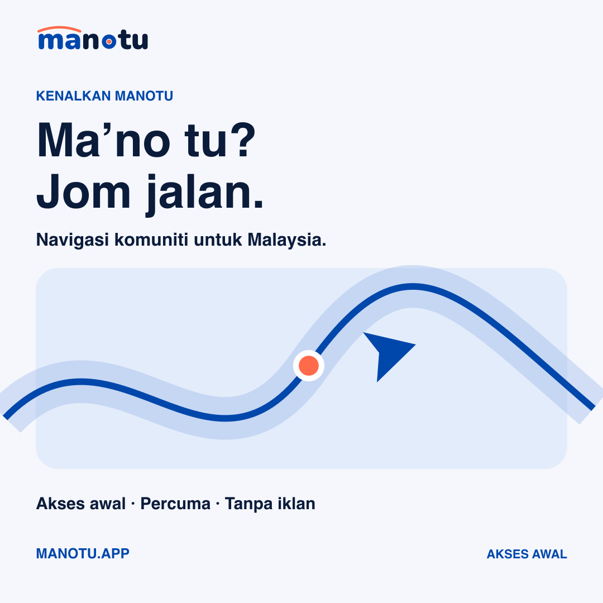
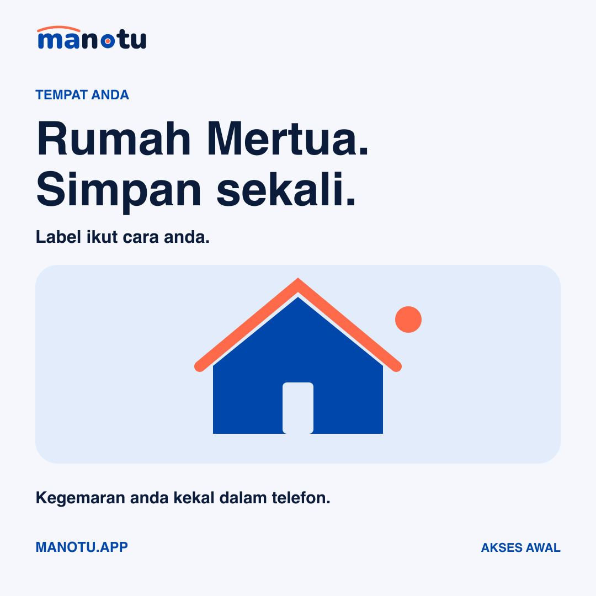
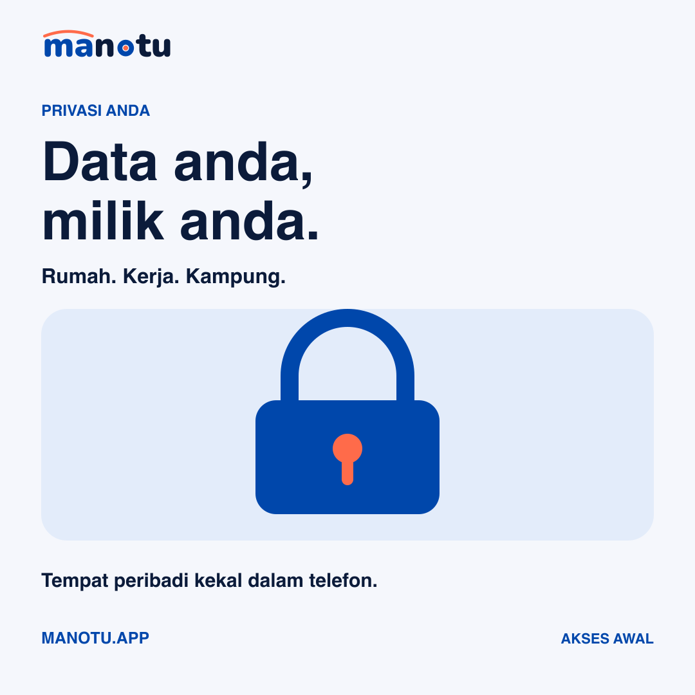
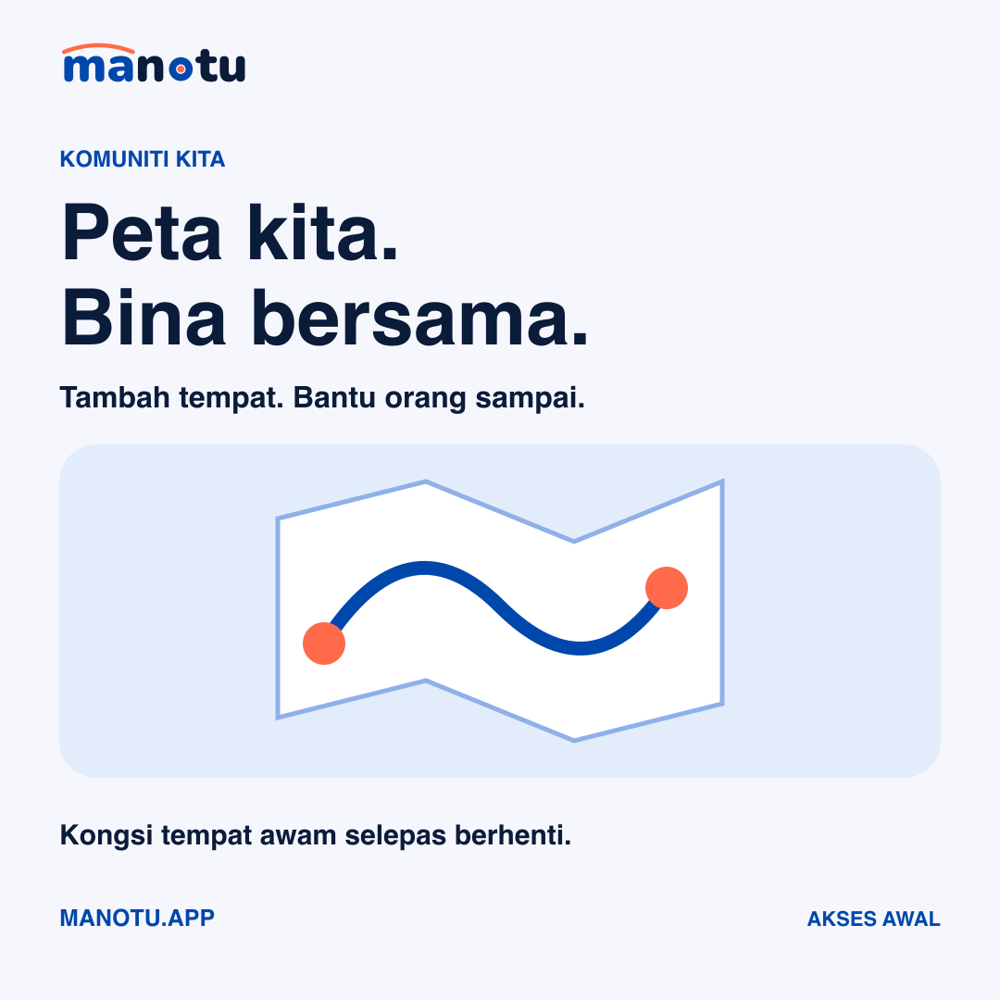

# Manotu · Launch post captions

Drafts only. No posts published.

## Day 1 · Pin this post: Kenalkan Manotu

### Facebook

Ma’no tu? 🪁 Kenalkan Manotu, aplikasi navigasi komuniti untuk Malaysia.

Cari tempat, rancang perjalanan dan simpan kegemaran anda dalam telefon. Percuma, tanpa iklan.

Kami masih dalam akses awal. Cuba satu laluan yang anda kenal dan berikan maklum balas melalui app selepas berhenti dengan selamat.

Lihat pilihan muat turun: https://manotu.app/

EN: Community navigation for Malaysia. Early access—help us improve it.

#Manotu #NavigasiMalaysia #KomunitiMalaysia

### Instagram

Ma’no tu? Jom jalan. 🪁
Manotu: navigasi komuniti Malaysia. Percuma, tanpa iklan. Kami masih dalam akses awal—jom cuba dan bantu kami tambah baik.

Pilihan muat turun di pautan bio.
#Manotu #NavigasiMalaysia #KomunitiMalaysia

Alt text: Cobalt route line, coral destination dot and arrow under the headline Ma’no tu? Jom jalan.

## Day 3 · Conversation: Rumah Mertua

### Facebook

Label paling jujur dalam telefon anda? “Rumah Mertua.” 😄

Dalam Manotu, labelkan tempat kegemaran ikut cara anda: Kampung, Kedai Mak atau Rumah Mertua. Kegemaran itu kekal dalam telefon anda.

Apa label paling kelakar yang anda akan guna? Kongsi nama umum sahaja—jangan kongsi alamat atau lokasi peribadi.

Cuba Manotu: https://manotu.app/

EN: Your places, your labels. Saved on your phone.
#Manotu #RumahMertua #BalikKampung

### Instagram

Rumah Mertua. Simpan sekali. 😄
Kampung, Kedai Mak atau Gym Yang Jarang Pergi—apa label pilihan anda?

Komen nama umum sahaja, bukan alamat. Kegemaran anda kekal dalam telefon.
Cuba Manotu melalui pautan bio.
#Manotu #RumahMertua #BalikKampung

Alt text: Simple cobalt house with coral roof on pale blue, alongside Rumah Mertua. Simpan sekali.

## Day 5 · Trust: Data anda, milik anda

### Facebook

Rumah. Kerja. Kampung. Tempat peribadi anda bukan bahan iklan. 🔒

Kegemaran dan sejarah carian Manotu disimpan dalam telefon anda, bukan di pelayan kami. Tiada iklan atau SDK penjejakan.

Manotu menerima sumbangan yang anda pilih untuk kongsi secara awam serta isyarat trafik tanpa nama semasa navigasi. Baca janji dan penjelasan privasi: https://manotu.app/privacy/

EN: Your favourites and search history stay on your phone.
#Manotu #Privasi #DataAndaMilikAnda

### Instagram

Data anda, milik anda. 🔒
Kegemaran dan sejarah carian kekal dalam telefon anda. Tiada iklan atau SDK penjejakan.

Sumbangan awam dan isyarat trafik tanpa nama diterangkan dalam dasar privasi. Baca melalui laman di bio.
#Manotu #Privasi #DataAndaMilikAnda

Alt text: A cobalt padlock with a coral keyhole, with the headline Data anda, milik anda.

## Day 8 · Participation: Peta kita, bina bersama

### Facebook

Kedai kecil yang orang selalu terlepas? Surau yang baru dibuka? 🗺️

Bantu orang lain sampai. Cuba ciri Tambah tempat dalam Manotu untuk mencadangkan tempat awam yang anda kenal. Cadangan tertakluk pada semakan.

Buat selepas berhenti dengan selamat. Jangan hantar alamat rumah atau tempat peribadi sebagai tempat awam.

Jom bina bersama: https://manotu.app/
Kod tulisan Manotu berlesen MIT: https://github.com/erymuzuan/manotu
Komponen platform Google dan Apple turut digunakan.

#Manotu #KomunitiMalaysia #SumberTerbuka

### Instagram

Peta kita. Bina bersama. 🗺️
Tahu tempat awam yang belum ada? Cuba Tambah tempat dalam Manotu. Cadangan tertakluk pada semakan.

Buat selepas berhenti dengan selamat. Tempat peribadi jangan dikongsi secara awam.
Pautan di bio.
#Manotu #KomunitiMalaysia #SumberTerbuka

Alt text: Folded map illustration with a cobalt route joining two coral dots, headed Peta kita. Bina bersama.
